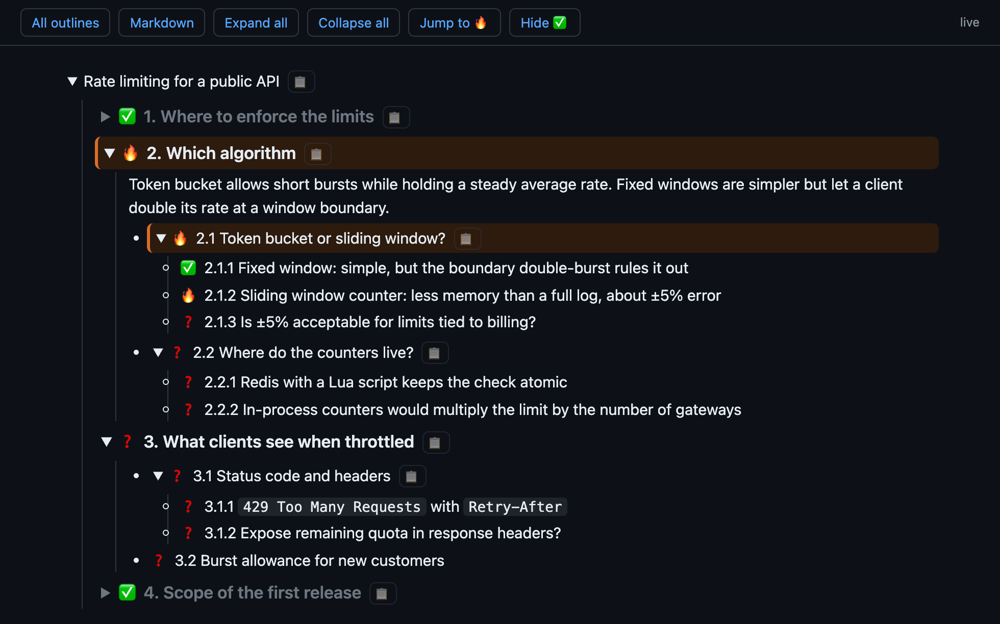

# Live Discussion Outline

**A working interface that keeps the whole conversation inside human attention — and it's already replaced my chat.**

An agent can hold a million tokens and attend to all of them at once. You can hold a handful of things. So in a long session with a coding agent, the bottleneck is not the model, it is you: you lose the thread, forget what was decided three topics ago, and scroll back up to find the one answer you need while the chat keeps growing below you.

This is not a companion to the chat. It replaces it. The agent keeps a numbered, collapsible outline of the work as it goes (topics, claims, decisions, what is still open) and you live in that outline: you read it, approve nodes, pick options, run actions and type your next message, all from the page. The transcript is still there, one tab away, for the rare time you need it.

I have been building and using it for a few days, and it has already replaced the chat for me completely. It feels cognitively different: lighter, calmer, easier to think in.

## Why the agent writes it

Tools that visualize a conversation read the transcript after the fact and redraw it: a tree of messages, a nicer chat window. They work with any chat, and the agent never knows they exist. But a transcript only holds what was said. It cannot tell which points are settled, which are claims waiting for your approval, what needs a decision, or what can be folded away. Only the agent understands the work well enough to know that.

So here the agent is asked (by a skill, or a rules file) to maintain the outline as part of its job. That costs some tokens on every turn. In return you get something no transcript reader can produce: a curated, human-sized map of the work, a **comprehension layer** between an agent that has all the information and a person who needs to understand it.

## Continuity of understanding

The agent moves at machine speed. Your understanding has to update at human speed: one thing at a time, never in a sudden jump. Every part of the page follows from that one rule.

- **The outline.** Detail is folded away and you open only what you are looking at. The relief does not come from seeing everything at once (no one can), but from not having to.
- **The queue.** The outline is the map of what has happened; the queue is the pointer to what comes next. At the end of each turn the agent triages everything still open and lists, in order, what needs you: decide this, run that, approve this, read that.
- **The approval loop.** Ticking a node or picking an option is recorded in the outline at once, and the agent is told with your next message. Steering happens where you read.
- **A view that holds still.** The agent rewrites the outline constantly, but your scroll position and what you have open never jump. Your sense of where things are stays valid.
- **Change shown as motion.** When the agent rewrites a node you have already read, the page keeps showing what you read and marks it with a diff icon. Only when you click does it animate the old text into the new, word by word. People cannot diff two states in their heads; they can follow a change as it happens.

## How it works

The server owns the outline. The agent and you are both its clients: the agent sends nodes, claims and the queue; you send approvals, picks and runs; each learns from the server what the other did ([ADR 0003](docs/adr/0003-the-server-owns-the-outline.md)).

There are three parts:

1. **A plugin for the agent** ([`plugin/`](plugin)): a skill you invoke (`/outline-only:outline`), three MCP tools (`start`, `read`, `change`) and two hooks. The skill holds only judgment: what to mirror, what counts as a claim, when an action may run. The tools carry the changes. The hooks hand the agent what you did on the page with each prompt, and the outline's map after compaction or resume.
2. **A small local server** that keeps each outline as a markdown file in the outlines folder and is the only thing that writes it. It keeps numbers unique, rolls statuses up, marks the current node, keeps the queue's kinds right, and refuses a change that breaks a rule, saying why.
3. **The page**, served at `http://localhost:4577`: it collapses and expands nodes and updates in place on every change.

It is built and used day to day with Claude Code, which gets the most out of it (the Terminal and Transcript tabs, the input box). Any agent that can run a stdio MCP server can keep an outline; see below.



The example in [`examples/demo/rate-limiting.md`](examples/demo/rate-limiting.md) is the markdown behind this screenshot.

## Features

- Every point and sub-point is numbered with its full path (`1`, `1.1`, `2.3.1`), in the chat and in the page, so "2.1" means the same thing in both places.
- Every point is a **node**: a numbered heading (`# 2. Topic`, `## 2.1 Title`, down to six levels) plus its text, which is ordinary markdown, plain bullets included. Status and other tags sit on the heading line after the number. The node under discussion carries an `@current` tag; the page draws an orange line on it and on every ancestor on its path. Approved topics start collapsed.
- A pane on the left of every page lists all outlines, grouped by project like Claude's sidebar: workspaces first (a project named like a `.code-workspace` file that New can start from), then single folders, each group by its latest change and its outlines newest first. A search box at its top filters it (every word must appear in the title or the project), **New** under it starts a session from any page, and a session just started shows as a row with a spinner until its outline appears. Hovering a row shows its rename pencil and trash button. Drag the pane's right edge to resize it (double-click resets it); `/` shows only the pane.
- **Resume later:** an outline can carry a `Resume:` line (a link or command that reopens the chat it came from). The page has a **Copy chat link** button, so you can find a paused discussion and reopen its chat. See `resumeTemplate` below.
- A **Markdown** button at the top switches to the plain rendered markdown (a normal preview, nothing collapsible) and back; the choice is remembered per outline.
- The discussion's title (the outline's `Title:` line) shows in the top bar. To rename it, hover its row in the pane and click the pencil: type a new name, press Enter to save or Escape to cancel.
- Nodes below a topic show as chat-style bubbles, one level of nesting inside another: number (last segment, full path on hover), title and text. Click anywhere on a parent row (outside its checkbox and buttons) to collapse or expand it; the circled number next to the side-chat button counts its direct children and fills in while the row is collapsed. Hovering a node also shows a trash button: it puts the node in the message box as a tag with a trash icon, and the box asks why it should be removed; sending it sends `Removed from the outline: <path and name>` and your reason, and the agent takes the node out. Without a linked session it copies that line to paste into the chat.
- Each node has a checkbox drawn from its status tag (none: open, `@agent-claim`: the agent's claim, `@user-approved`: you approved it; the tags name who, and the older `@claim` and `@approved` still read the same). A claim shows a blue outlined tick. A parent node shows the unique set of its descendants' icons (empty, blue agent tick, green human tick); if they all match, the parent shows that one icon. If any child is unchecked, the parent includes an empty checkbox. Ticking a parent also ticks every descendant. Ticking an open box, or clicking a blue agent tick, approves the node: the server writes the approval into the outline at once and the box shows a green outlined tick (no checkbox is filled green). The agent learns of it with your next message and in the result of its next change; it is not interrupted. When the agent later rewrites a node you approved, the node is its claim again until you approve the new wording. A node tagged `@options` with child option nodes is a single choice (each option is tagged with its letter, `@option_A`, `@option_B`, which the page shows as `(A)`, `(B)` before the title; older outlines type the letter into the title): it shows a "◉ Pick one" tag, its options render as radio buttons (choosing one clears the others and answers the question), and the option tagged `@recommended` shows a blue outlined dot and a 💡 Recommended tag. `@options` on a leaf shows a red "❓ Options" tag. `@Recommendation.` in the node's text puts a 💡 Recommendation tag in the content cell, below the explanation and immediately before the recommendation, in that same cell, and shows the checkbox as a blue outlined tick.
- Page bar: the tabs, then expand all, collapse all, and jump to the current node. Which items you opened or closed is kept per outline by the server.
- **Terminal tab:** if the agent runs inside [tmux](https://github.com/tmux/tmux), the outline records the tmux session (`Terminal:` line) and the page gets a tab that shows that session's live terminal ([xterm.js](https://xtermjs.org)). Your own terminal and the page are two views of the same session: type in either. Start the agent with `tmux new -s <name> claude` (any agent works), then invoke the skill. The server sets `mouse on` for that tmux session so scrolling and clicks reach the agent.
- **Transcript tab:** with Claude Code, the outline also records the session id (`Session:` line) and the page gets a tab that renders the session's transcript as messages (your prompts, Claude's answers as markdown, tool calls collapsed with their input and output), updated live. It reads Claude Code's own log under `~/.claude/projects`, an internal format that may change. When the outline also has a `Terminal:` line, an input box at the bottom types your message into the tmux session as if you typed it there (Enter sends, Shift+Enter adds a line). Without tmux, for example in the desktop app, the tab is read-only.
- **Message box:** when the outline has a `Terminal:` line, a box at the bottom of the Outline, Markdown and Transcript tabs (one box, one draft) types your message into the session. On such a page each row's button adds a chip for that item to the message box, sent as a `Re: outline …` line before your text. Without a session, a row's button copies its reference instead.
- **Slash commands:** typing `/` at the start of the message box lists the commands the session can run, filtered as you type (arrows move, Tab or Enter completes, Esc closes): the skills the session itself lists (read from its transcript), user-only skills and commands from `~/.claude` and the project's `.claude` folder, and a short list of Claude Code built-ins, which may lag behind new versions. Commands that open a picker (`/resume`, `/config`, `/model` with no argument) show it in the Terminal tab.
- **Model and effort:** the dropdowns at the top right start from the outline's `Model:` line; changing one types `/model` or `/effort` into the session. Claude Code also saves that choice as your default for new sessions.
- **New session:** New, on the outline list and on every page, starts a session in tmux from a Cursor workspace, a folder, or a past Claude Code session (resumed), with the plugin loaded and its skill as the first message, and shows that session's terminal in the main area until the agent writes the outline's first version, then opens the outline. Workspace files are looked for beside the folders your recent sessions ran in; set `workspaceDirs` to search elsewhere.
- **Resuming a session open elsewhere:** the Resume tab marks sessions still running in another app ("open in Cursor", "open in tmux session …"). Starting one that runs in Cursor, VS Code, the desktop app or another terminal offers to stop it there first, since two apps writing one session conflict; one already in tmux is opened instead. A session started fresh with nothing running under it can go unnoticed.
- **Done parents collapse:** when your click approves the last open descendant of a node, or picks an option, that node collapses over half a second and the page scrolls it to the top, just below the sticky headers above it. It does not wait for the agent. If the click completes several levels at once (up to the topic), the outermost one animates and the inner ones close with it; undo opens them again.
- **Undo:** the undo button in the page bar, or ⌘Z outside a text field, takes back your last approval click: a node's or topic's checkbox, or an option pick. Every node that click changed goes back to its own previous state, so approving a parent over mixed children and undoing it restores each child as it was. The outline is put back at once, and a claim you had approved is a claim again. Steps are kept per outline by the server, up to 50.
- **Queue:** the agent ends the outline with a `# @queue` section listing, by priority, the items it advises you to handle next (`- 2.1.3 @decide …`, `@approve`, `@read`). The page shows them in a column in the Outline tab's left margin, beside the nodes they point at; items that arrive slide in from the right, and those that do not fit are counted on an ellipsis that lists them. Clicking one opens and highlights that item in the Outline tab. The node carries the same icon as its item, left of its checkbox, so the two are recognized as one: a red question mark for `@decide` (a question the agent has no recommendation for; the page shows a `@decide` item as `@approve` when its node already holds the agent's recommendation, such as a question with a `@recommended` option), a blue circled tick for `@approve` (a claim or recommendation of the agent's, a question with a recommended option included), an eye for `@read`; an action's icon is its play button. An item and its icon disappear as soon as you approve or pick it on the page, and the agent rewrites the queue after each answer. Node numbers must be unique: the page warns when two nodes share one, since an approval of one would reach the other.
- **Actions:** the agent tags nodes that propose something to do in the session (run tests, change code) `@action`; they get a red play button left of the checkbox. Pressing it types `Run in the outline: …` into the session's terminal (without one, the agent is told with your next message); the triangle stays red inside a turning red ring until the agent has done it and marks the node `@action-done` (or `@action-failed`, which shows a red "Failed" tag and keeps the play button for another try). The node then shows as changed, and opening the change turns its red "Action" tag into a yellow "Done" tag (a done action without an `@Action.` line carries the tag on its title). Picking an action option puts it in the queue (`@action`, a red play icon) rather than running it.
- **Closing lines:** a long node's text ends with `@Summary.` (one sentence summing up that text; answers go into the text itself or into child nodes, never into the summary), then `@Recommendation.`, then, on an action, `@Action.` (what running it will do). Each shows on its own line after a Summary, 💡 Recommendation or ▶ Action tag.
- **Working spinner:** left of the message box, it spins while the agent is in a turn: on as soon as the page sends something, off when the session's transcript records the end of the turn (needs the `Session:` line).
- **Messages:** for things it does not put in the outline (the outcome of a build or test you asked for in chat, a status), the agent posts a message with its `change` tool, optionally naming a node (a paragraph of its chat reply that starts with `@message` is read from the transcript too). A red envelope under the queue column lists the last ten, with an unseen count, and a node with messages (its own or its descendants') gets its own grey envelope listing just those. Nothing goes into the markdown.
- **Unread changes:** when the agent rewrites a node you have already seen (say, merging an answer into it), the page keeps showing what you read, with a blue diff icon left of its checkbox, so the outline doesn't jump. Hovering a parent node (or topic) shows a diff icon beside its reference button when anything under it changed; clicking it opens every change under that node at once, with the node staying where it is on the screen (changes out of view, or under a collapsed node, are taken in without animation). Clicking the diff icon, or the node's diff item at the top of the left pane, animates the bubble to the new text in up to four stages of half a second each: first the words about to go are marked, red for removed ones and orange for rewritten ones; then the removed words collapse together; then a cursor passes over the rewritten words, each collapsing while its replacement grows in beside it, in orange; then the cursor passes over the added words, which grow in one by one in green (pushing the rest of the text along). A stage with nothing to show is skipped, the colour of a word that came in fades out, and long texts go faster to fit. Nothing animates if the page is hidden or the system asks for reduced motion. What you have seen is kept per outline by the server; nodes that are new still appear right away.
- **Project:** the top bar shows the discussion's project (workspace or repo); its tooltip names the folder Claude runs in.
- **Delete:** the trash button on an outline's row in the pane, shown when you hover it, asks once, then moves the outline to `.trash/<project>/` in the outlines folder. The session and its transcript are untouched.
- The top bar stays one row: what doesn't fit moves into a `⋯` menu.
- The terminal socket, the transcript stream, and the input box accept only this machine's own page (loopback address, `localhost`/`127.0.0.1` host, and for typing, our own origin).
- Every row has a 📋 button; click it to copy a reference (`Re: outline "…" › 2.1 …`) to paste into the chat and continue about that item.
- The server keeps each outline as markdown (easy to read and diff) and renders it; the agent changes it through the plugin's tools.

## Setup

Requires Node 20.19+ (or 22.12+). The Terminal tab, and typing from the Transcript tab, also need tmux (`brew install tmux`). `npm install` also builds the page (a React app in `web/`, see below) into `web/dist` with Vite; node-pty ships prebuilt binaries for macOS and Windows (other platforms compile it, and if that fails the Terminal tab is just not offered).

```bash
git clone https://github.com/hepiyellow/live-discussion-outline
cd live-discussion-outline
npm install
```

### Claude Code

```bash
npm run install-plugin               # adds this checkout as a plugin marketplace and installs the outline-only plugin
claude --plugin-dir ./plugin         # or: load the plugin for one session, without installing it
```

Then, in any conversation, type `/outline-only:outline` (optionally with a topic). The agent starts the server if it is not running, opens an outline, builds it from the conversation so far, and replies with a link. The skill is user-invoked only (`disable-model-invocation: true` in [`plugin/skills/outline/SKILL.md`](plugin/skills/outline/SKILL.md)). Sessions started from the page's **New** button get the plugin from this checkout by themselves.

### Codex and other agents (untested)

The MCP process and the hook script use nothing agent-specific but two environment variables, so another agent needs three things:

1. **The MCP server**: `node <checkout>/plugin/scripts/outline-mcp.js` over stdio. For Codex, in `~/.codex/config.toml`:
   ```toml
   [mcp_servers.outline]
   command = "node"
   args = ["<checkout>/plugin/scripts/outline-mcp.js"]
   ```
2. **The instructions** in [`plugin/skills/outline/SKILL.md`](plugin/skills/outline/SKILL.md), as a skill or in the agent's rules file.
3. **The hooks**, where the agent has them: run `node <checkout>/plugin/scripts/outline-hook.js` on prompt submit and on session start after a resume or compaction. It reads the hook's JSON on stdin (`hook_event_name`, `session_id`, `cwd`, `source`) and prints what to add to the agent's context. Without hooks the agent still gets your approvals in every tool result.

The MCP process learns the session id from `CLAUDE_CODE_SESSION_ID` (or `CODEX_THREAD_ID`, unverified); without one, an outline is found again by the session's working folder.

### The tools

| Tool | What it does |
|---|---|
| `start` | Opens an outline for the session, or reattaches to the one it has. Returns the page link and the map. |
| `read` | Returns the whole outline, or one node and its descendants, as compact text. |
| `change` | Applies a list of operations together, or none of them: `add`, `update`, `move`, `remove`, `record`, `finish`, `message`, `queue`. |

The outline's file is plain markdown (a `Title:` line, numbered headings as nodes with `@` tags for status, ordinary markdown as each node's text). It is the server's storage: agents do not read or write it.

### The Mac app

```bash
npm run app    # builds "Outline Only.app", installs it in /Applications, and links the skill
```

The Outline app, named **Outline Only** in the Dock, runs the server while it is open and shows the page in one window; closing the window quits it and stops the server. It listens on a port of its own (`appPort` in the settings file, picked on the first launch and kept), so it and `npm start` do not compete for one. On its first run, when there is no settings file yet, it asks where outlines are kept, proposing `~/live-discussion-outlines`. **Settings › Change Outlines Folder…** (in the app's own menu) picks another folder and offers to move the outlines there, with the trash and what the page remembers for each outline; it first names the outlines whose session is still running, since those sessions keep writing to the old folder. Once installed, it writes `linkBase` into the settings file, and links of the form `outline-only://open/<project>/<file>` open it on that outline, starting it if needed; only the installed app takes them, not `npm run app:dev`. It is built for this Mac only: signed ad hoc, not notarized, with no updater, so run `npm run app` again after a `git pull` (quit the app first). `npm run app -- --build-only` leaves the app in `dist/` without installing it, and `npm run icon` rebuilds its icon from `app/icon/icon.svg`.

### Viewing

Open the URL in a browser, or in an editor tab (in Cursor/VS Code: command palette → **Simple Browser: Show**, paste the URL).

### How the page works

The page is a React single-page app fed by JSON over server-sent events ([ADR 0001](docs/adr/0001-react-spa-fed-by-json-over-sse.md), [plan](docs/plans/viewer-spa.md)), built from `web/` into `web/dist` by `npm install`. It shows the outline list at `/`, an outline at `/<project>/<file>`, and a session just started at `/live?t=<tmux session>`; links to the old `/app/…` paths redirect there.

It reads `/api/outline/<project>/<file>`: the outline as JSON (header lines, nodes, queue and the Markdown tab; `web/src/types.ts` describes it), parsed by `outline.js`. `/api/outline/<project>/<file>/events` streams it, sent again whenever that file changes, so an agent's edit re-renders only what changed. That stream is the only one an outline's page holds: it also carries the viewer state, the outline list for the pane, and the linked session (its messages, its activity and, with `?transcript=1`, its transcript). A browser allows six connections to one server across all its windows, so a page with a stream per kind of data left none for requests once two windows were open.

What the page remembers for you (open and closed nodes, unsent approvals, what you have read, undo steps, seen messages, the input box's draft and the tab shown) is kept by the server, one file per outline in `.state/` of the outlines folder (`/api/state/<project>/<file>`), so the Outline app and a browser show the same thing. Marks the old page kept in the browser (what you had read, unsent ticks) were not carried over.

```bash
npm run build    # rebuilds web/dist after a change to web/ (npm install does this too)
npm run dev      # or `npm start -- --dev`: serves web/src through Vite instead, reloading edits in place
npm test         # type-checks web/ and runs the tests in test/
npm run app:dev  # the Outline app from this checkout: builds the page, then runs the server and one window in Electron
```

The browser tests run headless Chromium through Playwright: install it once with `npx playwright install chromium`, or point `PLAYWRIGHT_CHROMIUM` at a Chromium binary you already have.

## Configuration

Settings come from one settings file, `~/.config/live-discussion-outline/config.json`, then defaults:

```json
{ "dir": "~/Documents/outlines", "port": 4577, "resumeTemplate": "myagent --resume {session}" }
```

| Setting | Key | Default |
| ------- | --- | ------- |
| Outlines folder | `dir` | `~/live-discussion-outlines` |
| Server port | `port` | `4577` |
| Bind address | `host` (or the `OUTLINE_HOST` environment variable) | `127.0.0.1` |
| Template for the resume link or command the agent writes into each outline; `{session}` is replaced by the chat's session id | `resumeTemplate` | none |
| Port the Outline app listens on; the app picks and writes it | `appPort` | a free port |
| Start of the links to outlines, followed by `/<project>/<file>`; the installed app writes `outline-only://open` | `linkBase` | `http://localhost:<port>` |

The file is at a fixed path, and no environment variable overrides the outlines folder, the port or the resume template: the agent and the server both read the file, so they cannot disagree about where outlines go ([ADR 0002](docs/adr/0002-the-outline-app-owns-the-server.md)). `OUTLINE_DIR`, `OUTLINE_PORT`, `OUTLINE_CONFIG` and `OUTLINE_RESUME_TEMPLATE` are no longer read; put those values in the file.

Outlines are stored as `<dir>/<project>/<date>-<topic>.md`, one folder per project, outside your repos. The page for a file is `http://localhost:<port>/<project>/<date>-<topic>`; `/` lists them all.

### Resuming a chat

How to reopen a chat depends on the agent, so the template is yours to configure. When an agent starts an outline, the server fills in the chat's session id and keeps the finished link or command as the outline's `Resume:` line. The page copies that line as written; the server never interprets it.

Examples (check your tool's docs for the exact form; these are the ones I know):

| Agent | `resumeTemplate` |
| ----- | ---------------- |
| Claude Code (terminal) | `claude --resume {session}` |
| Claude Code (editor extension) | `vscode://anthropic.claude-code/open?session={session}` (use `cursor://` in Cursor) |
| Codex CLI | `codex resume {session}` |

Web-only chat products (ChatGPT, Grok, …) cannot write files, so they cannot run the skill; to track such a chat, paste its URL as the outline's `Resume:` line yourself.

If the template is empty, the agent writes a `Resume:` line only when it knows its own way to reopen a chat, and otherwise leaves it out.

To apply new settings, stop the server (`pkill -f live-discussion-outline/server.js`) and start it again with `npm start` (or the next `/outline-only:outline` starts it).

## Notes

- Binds to localhost only. Raw HTML in the markdown is escaped. The server log is `~/.config/live-discussion-outline/server.log`: everything the server prints, crashes, commands that timed out and stalls of over a second, however the server was started.
- Topics and nodes with children become collapsible. The markdown stays readable in any viewer.
- The 📋 button only copies to the clipboard. Injecting text into an existing chat through an editor URI handler did not work when tried; the Terminal and Transcript tabs are the way to type into a discussion from the page.

## License

MIT
